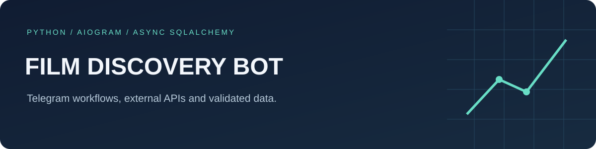

# Film discovery Telegram bot

A Python learning project using aiogram, SQLAlchemy's asynchronous sessions and the Kinopoisk API.

## Implemented scope

- Telegram menus for film lookup, ranked selections and random selections.
- Film catalog operations and administrator management.
- Pydantic models for API responses and submitted film data.

The current selection logic is not a trained ML recommender.

## Setup

Create and activate a Python virtual environment, then run:

```sh
python -m pip install -r requirements.txt
```

Create a local `.env` (never commit real credentials):

```dotenv
BOT_TOKEN=
KINOPOISK_API_KEY=
SELECTED_DB=SQLITE
```

For PostgreSQL set `SELECTED_DB=POSTGRES` and provide `DB_NAME`, `DB_PORT`, `DB_HOST`, `DB_PASS` and `DB_USER`.
Use an isolated demo database and a test bot.

```sh
python main.py
```

The entry point is `main.py`; the Telegram library is aiogram.

## Layout

- `bot/handlers/`: user menus, administrative callbacks and film editing states.
- `apis/kinopoisk.py`: external film API calls.
- `Pydantic/`: validation models.
- `DB/`: models, sessions and database requests.

## Current limitations

- Administrative message and callback handlers verify current administrator membership on every step. Add the initial administrator only through a trusted database session; there is no public bootstrap command.
- Startup creates missing tables without dropping existing tables. Runtime SQLite defaults to `.data/user.db`; `DB_PATH` can select another local file. The historical committed database is not used by default.
- SQLite paths use the platform path library. PostgreSQL requires the documented environment configuration.
- The repository includes a SQLite database. Its records have not been certified as safe sample data.
- API requests use asynchronous aiohttp sessions, HTTP status checks and a 15-second timeout. API errors currently propagate to the bot framework; user-facing retry messages remain future work.
- Run `python -m pip install pytest==8.4.1 pytest-asyncio==1.2.0`, then `python -m pytest -q tests`. Checks cover access denial, revoked rights, real callback dispatch and preservation of database records. CI runs the suite on pushes and pull requests.

Previously exposed API credentials require rotation even after removing them from source.

## License

See [LICENSE](LICENSE). No license terms were changed.
